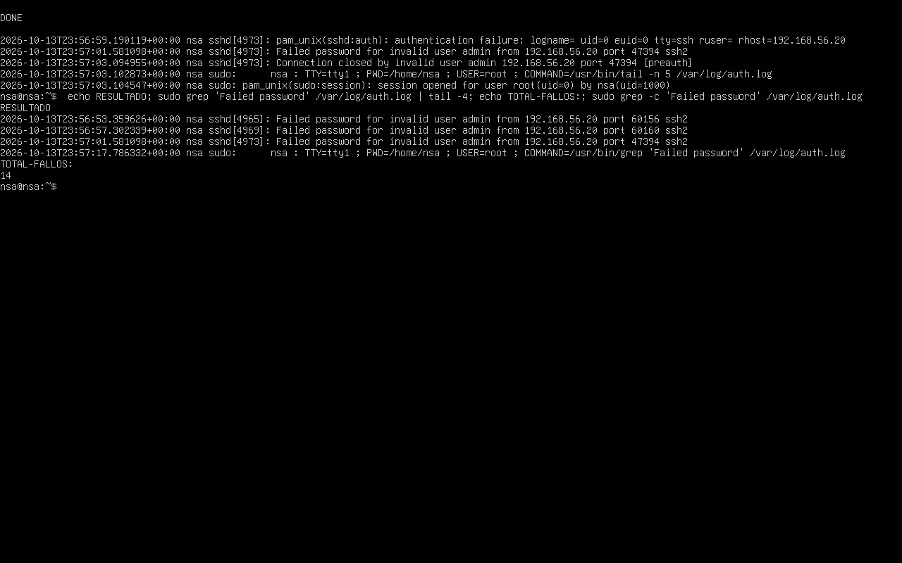
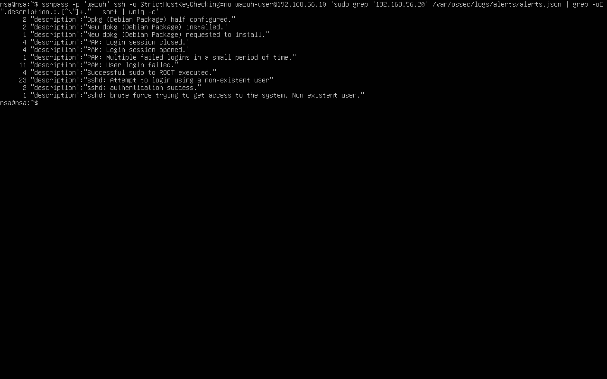

# Informe de incidente · INC-01 · Fuerza bruta SSH

| Campo | Valor |
|---|---|
| Analista | Ignacio Sánchez Alós |
| Fecha detección | 2026-10-13 23:57 UTC |
| Severidad | Media |
| Estado | Cerrado (ataque simulado en laboratorio) |
| Activo afectado | `victima-ubuntu` (192.168.56.20) · servicio SSH |
| Reglas Wazuh | 5710 · 5712 · 5551 (ruleset por defecto) + regla propia 100010 |
| MITRE ATT&CK | Credential Access · Brute Force: Password Guessing (T1110.001) |

## 1. Resumen ejecutivo

Se detectó un ataque de fuerza bruta contra el servicio SSH de `victima-ubuntu`.
Un origen (192.168.56.20, dentro de la red del laboratorio) realizó múltiples
intentos de autenticación fallidos usando el usuario inexistente `admin`. El
SIEM Wazuh correlacionó los fallos y generó una alerta de fuerza bruta de nivel 10.
El ataque no tuvo éxito: ninguna credencial era válida.

> Ataque **simulado** de forma controlada en un entorno aislado para validar la
> capacidad de detección del SOC.

## 2. Cronología (UTC)

| Hora | Evento | Fuente |
|---|---|---|
| 23:56:53 | Primer intento de acceso fallido (usuario `admin`) | sshd / auth.log |
| 23:56:53–23:57:03 | 14 intentos fallidos consecutivos desde la misma IP | sshd / auth.log |
| ~23:57:03 | Wazuh dispara la alerta de fuerza bruta (regla 5712) | Wazuh manager |

## 3. Indicadores (IoCs)

- **IP origen:** 192.168.56.20
- **Usuario objetivo:** `admin` (inexistente en el sistema)
- **Servicio:** SSH (tcp/22) en 192.168.56.20
- **Volumen:** 14 fallos de contraseña en ~10 segundos

## 4. Análisis

El agente Wazuh de la víctima recoge `/var/log/auth.log`. Los intentos
generaron entradas `Failed password for invalid user admin from 192.168.56.20`.
El manager las decodificó y, al superar el umbral de fallos desde la misma IP,
elevó la detección de eventos individuales (regla 5710, nivel 5) a una alerta de
fuerza bruta (regla 5712, nivel 10).

Alertas registradas para el origen 192.168.56.20:

| Nº | Descripción de la alerta | Regla |
|---|---|---|
| 23 | sshd: Attempt to login using a non-existent user | 5710 |
| 11 | PAM: User login failed | 5503 |
| 1 | PAM: Multiple failed logins in a small period of time | 5551 |
| 1 | **sshd: brute force trying to get access to the system** | **5712** |

Evidencia:

## 5. Contención y respuesta

En el laboratorio no se aplicó bloqueo automático (el ataque era controlado).
En un entorno real, la respuesta sería:
- Bloquear la IP origen en el firewall.
- Revisar si alguna sesión llegó a autenticarse.
- Revisar el resto de servicios expuestos desde esa IP.

## 6. Recomendaciones

- Desplegar **fail2ban** o la opción `deny` de `pam_faillock` para bloquear tras N fallos.
- Deshabilitar el acceso SSH por contraseña y usar **claves**.
- Restringir SSH por IP de origen (firewall / `AllowUsers`).
- Activar **MFA** para accesos administrativos.

## 7. Lecciones aprendidas

- El ruleset por defecto de Wazuh ya detecta la fuerza bruta SSH sin reglas propias;
  la regla propia 100010 refuerza la correlación (8 fallos / 2 min desde la misma IP).
- El agente debe estar leyendo `/var/log/auth.log` (o journald) para que la
  detección funcione: conviene verificarlo tras instalar el agente.
