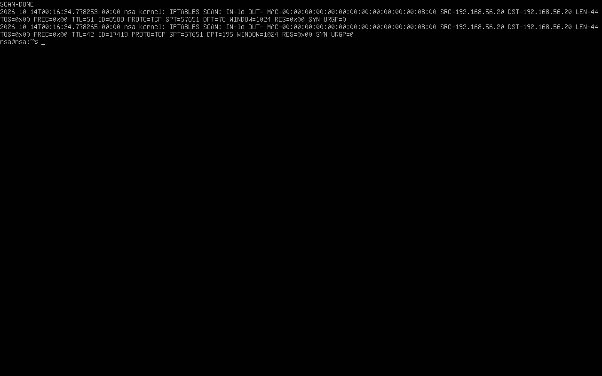
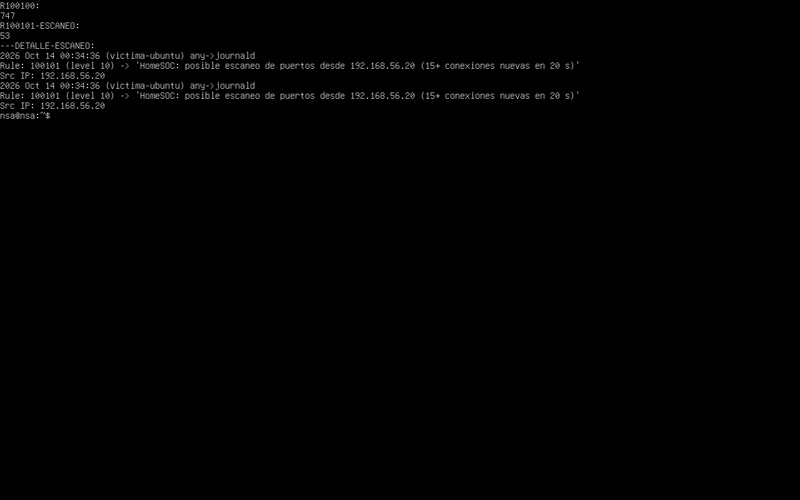

# Informe de incidente · INC-02 · Escaneo de puertos

| Campo | Valor |
|---|---|
| Analista | Ignacio Sánchez Alós |
| Fecha detección | 2026-10-14 00:34 UTC |
| Severidad | Media |
| Estado | Cerrado (ataque simulado en laboratorio) |
| Activo afectado | `victima-ubuntu` (192.168.56.20) |
| Reglas Wazuh | 100100 (conexión nueva) + **100101** (escaneo) — reglas propias sobre el decoder nativo `kernel`/`4100` |
| MITRE ATT&CK | Discovery · Network Service Discovery (T1046) |

## 1. Resumen ejecutivo

Se detectó un **escaneo de puertos TCP** contra `victima-ubuntu`. Un origen
(192.168.56.20, dentro de la red del laboratorio) estableció cientos de conexiones
nuevas hacia muchos puertos distintos en pocos segundos (barrido con `nmap -sS`,
puertos 1–400). Wazuh correlacionó el volumen de conexiones y generó una alerta
de escaneo de puertos de nivel 10.

> Ataque **simulado** de forma controlada en un entorno aislado.

## 2. Cadena de detección

1. En la víctima, una regla **iptables LOG** registra en `kern.log` cada conexión
   nueva proveniente de la red del laboratorio, con el prefijo `IPTABLES-SCAN:`.
2. El **agente Wazuh** lee `/var/log/kern.log` y envía los eventos al manager.
3. El decoder nativo `kernel` (regla padre `4100`, *Firewall rules grouped*)
   extrae `srcip`, `dstport` y `protocol`.
4. La **regla propia 100100** marca cada conexión nueva registrada.
5. La **regla propia 100101** se dispara cuando se acumulan 15+ conexiones nuevas
   desde el mismo origen en 20 segundos → **escaneo de puertos**.

## 3. Indicadores (IoCs)

- **IP origen:** 192.168.56.20
- **Objetivo:** 192.168.56.20, puertos TCP 1–400
- **Volumen:** 747 conexiones nuevas registradas; la regla de escaneo se disparó 53 veces durante el barrido.

## 4. Análisis

El patrón es inequívoco: un único origen abriendo conexiones a un rango amplio de
puertos en muy poco tiempo. El tráfico legítimo no genera decenas de conexiones
nuevas por segundo hacia puertos consecutivos. La correlación por frecuencia
(15 conexiones / 20 s desde la misma IP) distingue el escaneo del ruido normal.

Evidencia:

## 5. Contención y respuesta

En un entorno real:
- Bloquear la IP origen del escaneo en el firewall.
- Revisar qué puertos respondieron (servicios expuestos) y si hubo conexión posterior.
- Vigilar a ese origen por si el escaneo es la fase previa de un ataque.

## 6. Recomendaciones

- Exponer solo los puertos estrictamente necesarios (principio de mínima superficie).
- Desplegar reglas de *rate-limiting* / *port-scan detection* en el firewall.
- Alertar y, si procede, bloquear automáticamente los orígenes que escanean.

## 7. Lecciones aprendidas

- No siempre hace falta un decoder propio: el decoder nativo de Wazuh (`kernel`,
  regla `4100`) ya extrae los campos del log de iptables. La regla propia solo
  tiene que **encadenarse con `if_sid` a la regla padre nativa**, no competir con ella.
- La herramienta `wazuh-logtest` es clave para depurar: muestra qué decoder y qué
  regla casan con una línea de log concreta.
