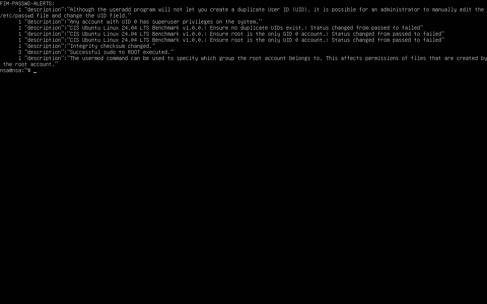

# Informe de incidente · INC-03 · Modificación de /etc/passwd (FIM)

| Campo | Valor |
|---|---|
| Analista | Ignacio Sánchez Alós |
| Fecha detección | 2026-10-14 00:11 UTC |
| Severidad | Alta |
| Estado | Cerrado (ataque simulado en laboratorio) |
| Activo afectado | `victima-ubuntu` (192.168.56.20) · fichero `/etc/passwd` |
| Detección | FIM (syscheck, regla 550) + SCA/CIS (cuentas con UID 0) + regla propia 100200 |
| MITRE ATT&CK | Persistence · Create Account: Local Account (T1136.001) · Account Manipulation (T1098) |

## 1. Resumen ejecutivo

Se detectó la creación de una **cuenta puerta trasera con privilegios de root
(UID 0)** mediante la modificación directa del fichero `/etc/passwd` en
`victima-ubuntu`. Wazuh detectó el cambio por dos vías independientes:

1. **Integridad de ficheros (FIM):** alerta *"Integrity checksum changed"* sobre
   `/etc/passwd` en tiempo real.
2. **Evaluación de configuración (SCA / CIS):** los controles *"root es la única
   cuenta con UID 0"* y *"no existen UID duplicados"* pasaron de `passed` a `failed`.

> Ataque **simulado** de forma controlada en un entorno aislado.

## 2. Cronología (UTC)

| Hora | Evento | Fuente |
|---|---|---|
| 00:11 | Se añade la línea `svc-backup:x:0:0:...:/bin/bash` a `/etc/passwd` | Simulación |
| 00:11 | FIM en tiempo real detecta el cambio de checksum | Wazuh (regla 550) |
| 00:11 | SCA marca como `failed` los controles CIS de cuentas UID 0 | Wazuh (SCA) |

## 3. Indicadores (IoCs)

- **Fichero modificado:** `/etc/passwd`
- **Cuentas maliciosas creadas:** `backdoor` y `svc-backup`, ambas con **UID 0 / GID 0** (equivalentes a root) y shell `/bin/bash`.
- **Técnica:** creación de cuenta con UID 0 para persistencia y escalada.

## 4. Análisis

El agente tiene configurada la vigilancia de integridad (syscheck) sobre `/etc`
en **tiempo real** (`realtime="yes" report_changes="yes"`). Al modificarse
`/etc/passwd`, el agente calculó el nuevo checksum, lo comparó con la línea base
y envió el evento al manager, que generó la alerta *Integrity checksum changed*
(regla 550, nivel 7).

De forma independiente, el módulo SCA (benchmark CIS Ubuntu 24.04) reevaluó los
controles de cuentas y detectó que `root` ya no era la única cuenta con UID 0.
Esta doble detección es muy valiosa: el FIM dice **qué fichero** cambió y el SCA
dice **por qué es peligroso** (cuenta privilegiada no autorizada).

Alertas registradas que referencian `/etc/passwd`:

| Descripción | Origen |
|---|---|
| Integrity checksum changed. | FIM (regla 550) |
| CIS: Ensure root is the only UID 0 account — passed → failed | SCA |
| CIS: Ensure root is the only GID 0 account — passed → failed | SCA |
| CIS: Ensure no duplicate UIDs exist — passed → failed | SCA |

Evidencia:

## 5. Contención y respuesta

En un entorno real:
- Eliminar de inmediato las cuentas `backdoor` y `svc-backup` de `/etc/passwd`.
- Restaurar `/etc/passwd` desde copia de seguridad y verificar `/etc/shadow`.
- Investigar cómo se obtuvo acceso con privilegios para modificar el fichero.
- Buscar otros mecanismos de persistencia (cron, systemd, claves SSH).

## 6. Recomendaciones

- Mantener FIM en **tiempo real** sobre ficheros críticos (`/etc/passwd`, `/etc/shadow`, `/etc/sudoers`).
- Alertar específicamente sobre la aparición de **cuentas con UID 0** distintas de root.
- Restringir quién puede escribir en `/etc` y auditar `useradd`/`usermod`.

## 7. Lecciones aprendidas

- La vigilancia **programada** (cada 12 h) es demasiado lenta para una demo o para
  una respuesta rápida; el **tiempo real** sobre `/etc` detecta el cambio en segundos.
- Combinar FIM + SCA da contexto: no solo "algo cambió", sino "se creó una cuenta
  privilegiada no autorizada".
